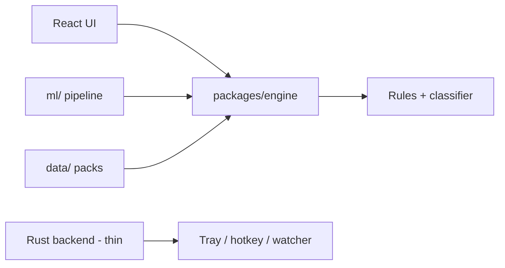

<div align="center">

# 🛡️ WolfShield

[](LICENSE)
[](https://github.com/shihabskytar/WolfShield/actions/workflows/ci.yml)
[](docs/ARCHITECTURE.md)
[](docs/THREAT_MODEL.md)

### An offline-first, open-source Windows app that tells you whether a message, link, or downloaded file is likely a scam, phishing attempt, or fake software — with a clear explanation, in Bangla, English, and Banglish.

**No accounts. No telemetry by default. Nothing uploaded. Your data stays on your PC.**

</div>

---

## The problem

Mobile-money fraud — fake bKash / Nagad / Rocket offers, OTP and PIN theft, fake job, loan, and lottery messages — phishing links, and malicious or cracked installers reach a very large number of people in Bangladesh. Most checkers are English-only, upload your data to a server, or are closed source.

WolfShield is built for the people those tools leave out: students, office workers, and shop owners on Windows 10 and 11, often on low-end hardware with slow or intermittent internet.

## What WolfShield does

> **M1 status — read this first.** The quick-check result card and the rules engine are built: paste a message or link and you get a verdict, a score, and the top signals with evidence, in Bangla or English. **The classifier, download watcher, tray, hotkey, clipboard check, and shell integration are NOT built yet** — they are M2–M4, plus a deferred M1 follow-up, in the roadmap below. Nothing in this README claims otherwise.

| Area | M1 status |
| --- | --- |
| Desktop shell | ✅ Tauri 2 app shell, React + TypeScript + Vite + Tailwind UI |
| Detection engine | ✅ Rules engine: URL/brand/text/file signals, 154 labelled fixtures |
| Quick-check result card | ✅ Verdict, score, top signals with evidence, bn/en reasons |
| i18n | ✅ Bangla (default) + English strings, no hard-coded UI text |
| Data packs | ✅ Versioned brand list + keyword packs, with provenance |
| Privacy | ✅ Offline by default, no telemetry, no accounts |
| Tray / hotkey / clipboard | ⏳ Deferred from M1 — see docs/DECISIONS.md (plugin verification pending) |
| Classifier / watcher | ⏳ M2–M3 — not yet built |

## Screenshots

```
┌─────────────────────────────────────────────────────────────┐
│  WolfShield — Quick check                                   │
│                                                             │
│  [ Bangla | English ]                                       │
│                                                             │
│  Paste a message or link here…                              │
│                                                             │
│  [ Check ]                                                  │
│                                                             │
│  This is an automated estimate, not a certainty.            │
│  Do not share your OTP or PIN with anyone.                  │
└─────────────────────────────────────────────────────────────┘
```

*The M1 result card is built (verdict, score, signals with evidence), but no screenshot image is linked here yet, so nothing on this page can break. Real screenshots will replace this placeholder in a later slice.*

## Quick start

### Prerequisites

- Windows 10 (1809+) or Windows 11, with Rust (via rustup) and WebView2
- [pnpm](https://pnpm.io/) and Node.js 20+

### Run

```bash
git clone https://github.com/shihabskytar/WolfShield
cd WolfShield
pnpm install
pnpm --filter @wolfshield/engine test
pnpm --filter @wolfshield/desktop tauri dev
```

Web UI only, without Tauri (useful for UI checks on Linux):

```bash
pnpm --filter @wolfshield/desktop dev
```

## Architecture



Full detail: [docs/ARCHITECTURE.md](docs/ARCHITECTURE.md)

| Layer | What it does |
| --- | --- |
| `apps/desktop` | Tauri 2 shell + React UI |
| `packages/engine` | Pure detection logic, zero UI / Tauri imports |
| `packages/shared` | Types, i18n strings, constants |
| `ml/` | Training pipeline skeleton (M2) |
| `data/` | Brand list, keyword packs, seed blocklist |

## How a verdict works (from M1)

Every verdict shows the top signals with the exact evidence and a plain-language reason in your UI language — never just a score, and never certainty. The UI always says: *"This is an automated estimate."*

Detail: [docs/DETECTION.md](docs/DETECTION.md) · Privacy and threats: [docs/THREAT_MODEL.md](docs/THREAT_MODEL.md) · Decisions: [docs/DECISIONS.md](docs/DECISIONS.md)

## Roadmap

- **M0 — Scaffold** ✅ monorepo, app shell, engine test, docs, CI
- **M1 — Quick check + rules engine** ✅ URL/text/brand/file rules, result card, 154 labelled fixtures — tray, hotkey, and clipboard check deferred to a follow-up slice (plugin verification pending, see docs/DECISIONS.md)
- **M2 — Classifier:** char n-gram TF-IDF + logistic regression, under 10 MB, lazy-loaded, rules-only fallback
- **M3 — Download watcher:** Downloads monitoring (opt-in), SHA-256, Zone.Identifier origin, file heuristics
- **M4 — Windows integration + settings:** shell menu, language/hotkey/autostart settings, first-run onboarding, optional local history (off by default)
- **M5 — Release pipeline:** signed NSIS installer, signed updater, winget manifest draft, SBOM, checksums

## Contributing

See [CONTRIBUTING.md](CONTRIBUTING.md) — setup in under 10 minutes, how to add a signal, a keyword pack, or a brand, and the PR checklist. Data contributions must include provenance and must never contain personal data.

## Security

See [SECURITY.md](SECURITY.md) for private vulnerability reporting. Code of conduct: [CODE_OF_CONDUCT.md](CODE_OF_CONDUCT.md). Signing intent for releases: [CODE_SIGNING_POLICY.md](CODE_SIGNING_POLICY.md). Changelog: [CHANGELOG.md](CHANGELOG.md).

## License

Apache-2.0 — see [LICENSE](LICENSE).

---

<div align="center">

**WolfShield — Think before you tap. Check before you trust.**

Built offline-first, for Bangladesh, in Bangla first.

</div>
